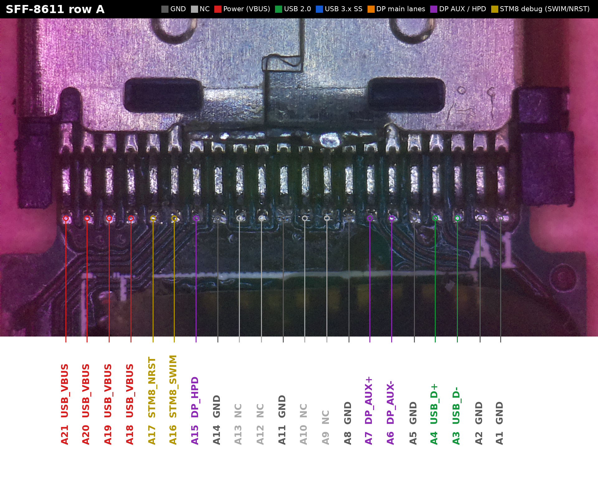
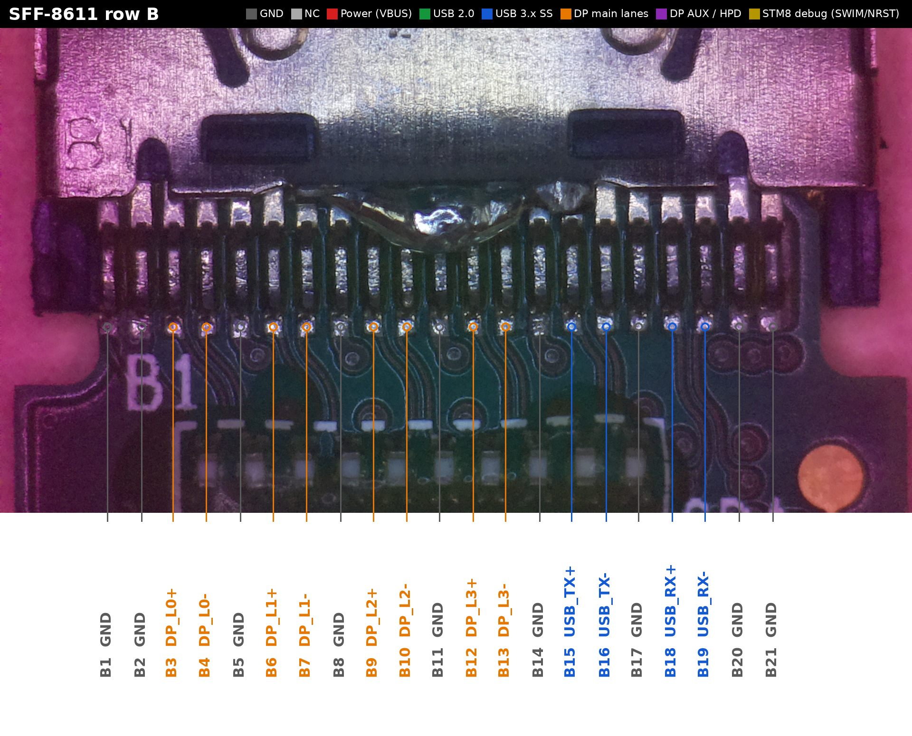
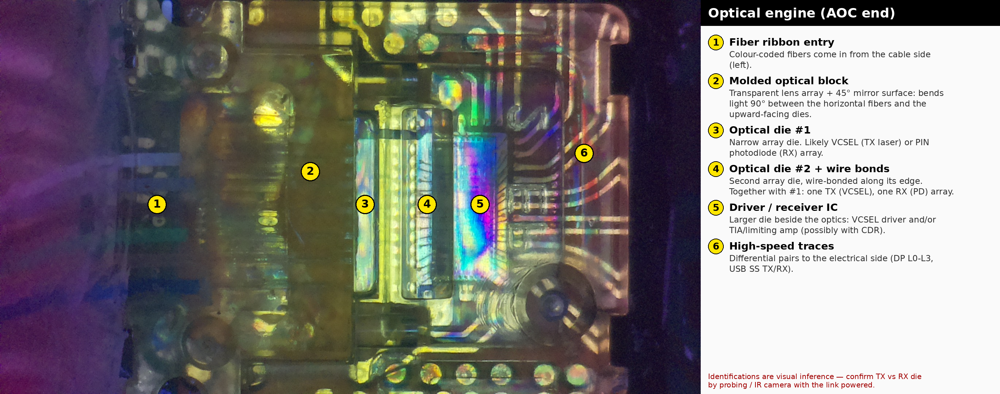

# Oculus Rift S Cable: SFF-8611 Pinout & Optical Engine Teardown

Reverse-engineered pinout of the SFF-8611 connector on the **Oculus Rift S** headset cable, a DisplayPort + USB active optical cable (AOC), plus notes on the optical engine inside.

## Connector overview

The connector has two rows of 21 pins:

- **Row A** carries low-speed and power signals: USB 2.0, DP AUX/HPD, VBUS, and STM8 debug pins.
- **Row B** carries the high-speed lanes: 4× DisplayPort main lanes and USB 3 SuperSpeed TX/RX, each pair separated by ground.

## Row A

Pin A1 is the **rightmost** pad (marked "A1" on the silkscreen).

| Pin | Signal | Pin | Signal |
|-----|--------|-----|--------|
| A1 | GND | A12 | NC |
| A2 | GND | A13 | NC |
| A3 | USB_D- | A14 | GND |
| A4 | USB_D+ | A15 | DP_HPD |
| A5 | GND | A16 | STM8_SWIM |
| A6 | DP_AUX- | A17 | STM8_NRST |
| A7 | DP_AUX+ | A18 | USB_VBUS |
| A8 | GND | A19 | USB_VBUS |
| A9 | NC | A20 | USB_VBUS |
| A10 | NC | A21 | USB_VBUS |
| A11 | GND | | |

## Row B

Pin B1 is the **leftmost** pad (marked "B1" on the silkscreen).

| Pin | Signal | Pin | Signal |
|-----|--------|-----|--------|
| B1 | GND | B12 | DP_L3+ |
| B2 | GND | B13 | DP_L3- |
| B3 | DP_L0+ | B14 | GND |
| B4 | DP_L0- | B15 | USB_TX+ |
| B5 | GND | B16 | USB_TX- |
| B6 | DP_L1+ | B17 | GND |
| B7 | DP_L1- | B18 | USB_RX+ |
| B8 | GND | B19 | USB_RX- |
| B9 | DP_L2+ | B20 | GND |
| B10 | DP_L2- | B21 | GND |
| B11 | GND | | |

### Cross-checks on the PCB

- On row B, the ground vias between the differential pairs line up with B5, B8, B11 and B14, and a via cluster sits under B20/B21.
- On row A, the wide copper area on the left lines up with the four USB_VBUS pins (A18–A21).

## Optical engine

| # | Part | Notes |
|---|------|-------|
| 1 | Fiber ribbon entry | Colour-coded fibers come in from the cable side. |
| 2 | Molded optical block | Transparent lens array with a 45° mirror surface that turns light 90° between the fibers and the upward-facing dies. |
| 3 | Optical die #1 | Narrow array die, likely the VCSEL (TX) or photodiode (RX) array. |
| 4 | Optical die #2 | Second array die, wire-bonded along its edge. With #3, one is likely TX and the other RX. |
| 5 | Driver / receiver IC | VCSEL driver and/or TIA/limiting amplifier, possibly with CDR. |
| 6 | High-speed traces | Differential pairs to the electrical side (DP L0–L3, USB SS TX/RX). |

> ⚠️ The optical engine labels are based on visual inspection only. Which die is TX and which is RX is not yet confirmed.

## TODO

- [ ] Design a prototype PCB for a proof of concept (POC) that will convert SFF-8816 to Mini DisplayPort and USB Type-C

## Contributing

Corrections, measurements, and photos are welcome. Please open an issue or a pull request.
